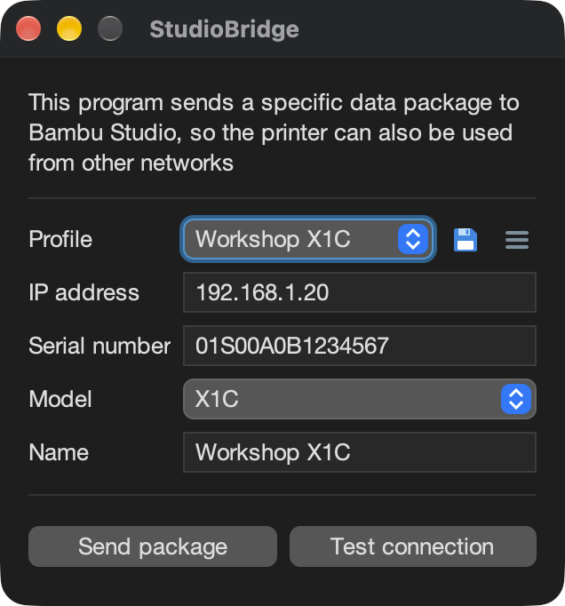
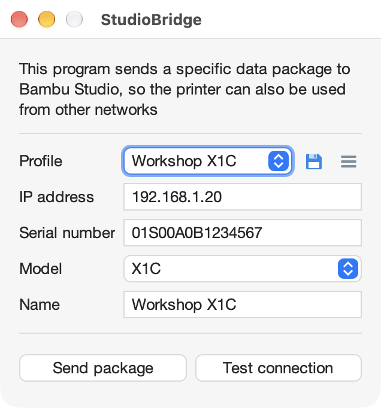
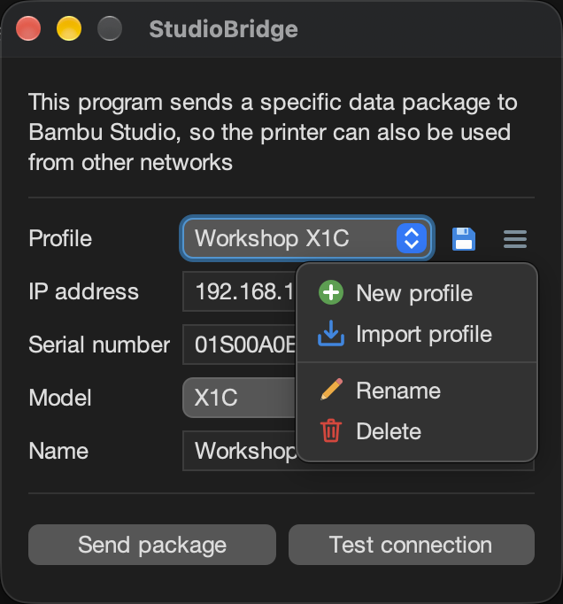
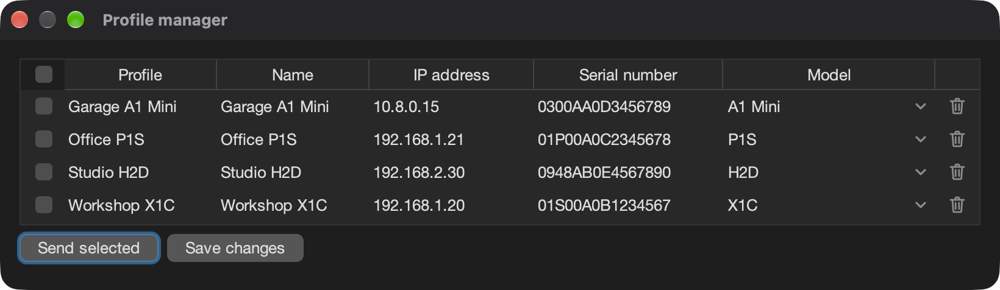
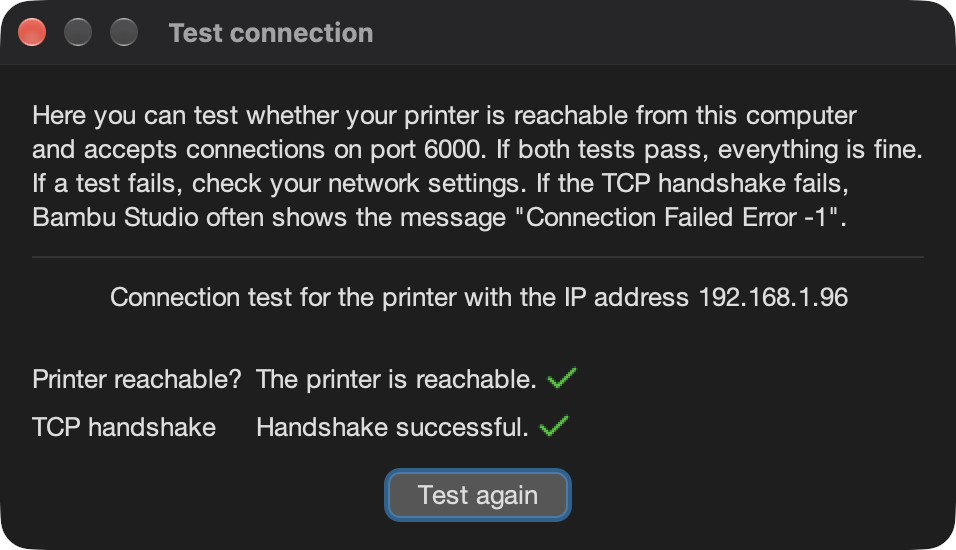

<p align="center">
  
</p>

<h1 align="center">StudioBridge</h1>

<p align="center">
  Make your Bambu Lab 3D printers visible in Bambu Studio or Orca Slicer — across any network.<br/>
  Connect printers from other subnets, VPNs, or your home network with a simple GUI.
</p>

<p align="center">
  
  
  
  
  
  
</p>

<p align="center">
  
  
  
  
  
</p>

---

StudioBridge makes Bambu Lab 3D printers visible in Bambu Studio or Orca Slicer when the slicer can not find them on its own: printers in another subnet, behind a VPN, or in a home network where discovery does not work.
There are many scripts for this, but many users feel more comfortable with a GUI. StudioBridge is based on the scripts found in countless forums and wraps them in a small app.

# How it works

StudioBridge sends the same UDP announcement a printer sends (IP address, serial number, model and name) to your slicer. The printer then shows up in Bambu Studio or Orca Slicer and is used with its LAN access code, with all the usual functions.

StudioBridge has nothing to do with Bambu Connect and does not replace it. It only makes the printer visible in your slicer.

# Features

- Every printer of the Bambu Lab range (A1, A1 Mini, A2L, P1P, P1S, P2S, X1, X1C, X1E, X2D, H2C, H2D, H2D Pro, H2S)
- **Profiles** for each printer: save, rename, import and delete them from the menu next to the profile list
- **Profile manager** (Settings → Profile manager): all profiles in one table, edit and save them, delete them, and send several printers at once
- **Test connection**: checks whether the printer is reachable and accepts connections the way Bambu Studio needs it
- **Sending mode**: as broadcast to the network (default) or only to Bambu Studio on this computer
- **English and German**, light and dark mode, both following the system by default
- **Command line** for scripts and autostart, see [Arguments](#arguments)

Successfully tested on:
- Windows 10/11 ARM and x86
- Linux Ubuntu 25.10 ARM and x86
- macOS M-Series (Apple Silicon)

> **Note for Intel Mac users:** Apple ends macOS support for Intel Macs, so native Intel (x86) builds are no longer provided. Intel Mac users can use the `.jar` release with Java 11 or later.

# Requirements
- The installers (Windows, macOS) and the AppImage (Linux) need nothing else
- The `.jar` release needs Java 11 or later, see [below](#installing-java-and-running-the-jar-file-only-for-using-jar)

# Preview

Main window in dark and light mode

<p>
  
  
</p>

The profile menu: new, import, rename and delete



The profile manager: edit, save, delete and send several printers



Test connection



If the TCP handshake fails, restarting the printer often helps.

# Languages

The GUI is available in English and German. **Settings → Language** picks one:

- **Automatic (system language)** (default): follows the language of the operating system, English when it is not available.
- **A fixed language**: always that one.

The new language is used after StudioBridge has been restarted. The output of the command line stays English.

**Settings → Appearance** works the same way: "Automatic (system setting)" (default) follows the light or dark mode of the operating system, "Light" and "Dark" fix it. It changes right away.

To add a language, copy `src/main/resources/i18n/en.properties` to `<code>.properties` (e.g. `fr.properties`), set `_name` to the language's name in itself, translate the values and add the code to `I18n.LANGUAGES`. Placeholders in braces (`{name}`, `{ip}`) must stay in place. Keys missing from a language fall back to English; `I18nTest` checks that every language has every English key with the same placeholders.

# Arguments

To use StudioBridge from Terminal, CMD or PowerShell, start it with arguments:

| OS | Command |
|---|---|
| macOS | `/Applications/StudioBridge.app/Contents/MacOS/StudioBridgeCLI` |
| Windows | `StudioBridgeCLI.exe` in the installation directory, standard: `C:\Program Files\StudioBridge` |
| Linux | the AppImage, e.g. `./StudioBridge-<version>-x86_64.AppImage` |
| JAR | `java -jar StudioBridge-<version>.jar` |

On Windows, use StudioBridgeCLI.exe: StudioBridge.exe has no console, so the output of the arguments would not be visible.

```
Options:
  Options can be combined, except --direct with --broadcast

Starting options:
  --noupdate             Skip search for latest updates on startup
  --sendonly             Start with no GUI, only send data from all printers to Bambu Studio
  --direct               Send the UDP package directly to Bambu Studio on this computer
  --broadcast            Send the UDP package as broadcast to the network
  --version              Show the version of StudioBridge
  --help                 Show help for StudioBridge

Profile options:
  --customProfilesDir='/path/to/profiles/'
      Load the profiles from this directory (only for this run)
  --selectedPrinters='/path/to/profile.sbp','/path/to/other/profile2.sbp'
      Send only these profiles, comma-separated (requires --sendonly)
```

--direct, --broadcast and --customProfilesDir only apply to the run they are given for. The settings chosen in the GUI stay as they are.

Examples (macOS):
```bash
/Applications/StudioBridge.app/Contents/MacOS/StudioBridgeCLI --sendonly --noupdate --direct
/Applications/StudioBridge.app/Contents/MacOS/StudioBridgeCLI --sendonly --customProfilesDir='/Users/rdiger-36/Documents/StudioBridgeProfiles'
/Applications/StudioBridge.app/Contents/MacOS/StudioBridgeCLI --sendonly --selectedPrinters='/Users/rdiger-36/Documents/My P1S.sbp','/Users/rdiger-36/Desktop/H2D-Pro Work.sbp'
```

Examples (Windows):
```bash
.\StudioBridgeCLI.exe --sendonly --noupdate --direct
.\StudioBridgeCLI.exe --sendonly --selectedPrinters='C:\Users\rdiger-36\Documents\My P1S.sbp','C:\Users\rdiger-36\Desktop\H2D-Pro Work.sbp'
```

With --sendonly the output looks like this:
```
*** StudioBridge by Rdiger-36 v.2.2.0 ***

Found 2 profile(s)!
Try to send all of them to Bambu Studio

Loading profile /Users/rdiger-36/.studio-bridge/Profiles/X1E.sbp
Successfully sent package via broadcast to Bambu Studio: Test Bambu X1E - 192.168.XXX.XXX - X1E

Loading profile /Users/rdiger-36/.studio-bridge/Profiles/P1S.sbp
Successfully sent package via broadcast to Bambu Studio: Bambu Lab P1S - 192.168.XXX.XXX - P1S

All Packages successfully sent. The printer(s) will appear in the next 60 seconds in Bambu Studio.
The program keeps sending for about 50 seconds and will exit automatically.
```

The exit code is 0 when every package was sent and 1 otherwise, e.g. when Bambu Studio is not running, no profile was found or an argument is wrong. A script can rely on it.

# Installing Java and Running the JAR File (Only for using .jar!)

The installers and the AppImage bring their own Java. Only the `.jar` release needs Java 11 or later installed.

**Installing Java**

- **Windows and macOS:** download a Java Runtime from [Adoptium](https://adoptium.net/) (Temurin, version 11 or later) and run the installer.
- **Linux:** install OpenJDK from your package manager, e.g. `sudo apt install openjdk-21-jre` on Debian and Ubuntu.
- Check it in a terminal with `java -version`.

**Running StudioBridge**

1. Download `StudioBridge-<version>.jar` from the [releases page](https://github.com/Rdiger-36/StudioBridge/releases/latest).
2. Double-click it, or start it in a terminal with `java -jar StudioBridge-<version>.jar`.

If double-clicking does not open it, start it from the terminal; the command shows what is missing.

# Support Me
<a href="https://ko-fi.com/rdiger36"></a>

A big thank you to all my [supporters](https://github.com/Rdiger-36/Rdiger-36/blob/main/SUPPORTERS.md)!
